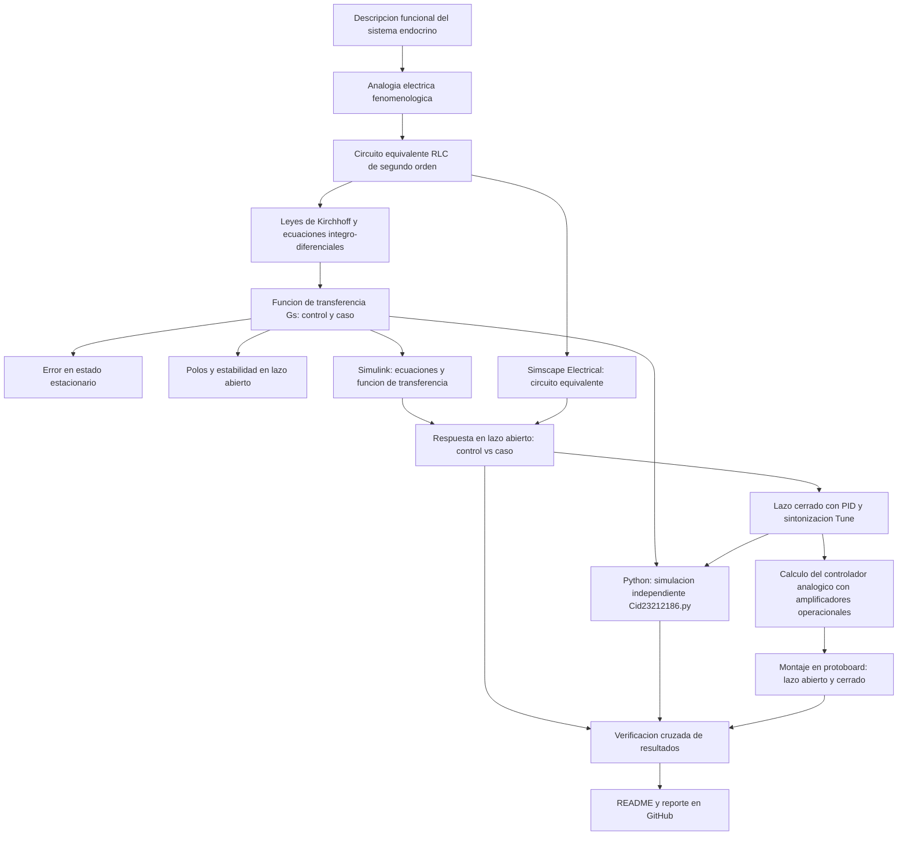

[](https://matlab.mathworks.com/open/github/v1?repo=l23212186-ops/MSFP4)

# Práctica — Modelado y control del sistema endocrino

Repositorio académico de la asignatura **Modelado de Sistemas Fisiológicos**, correspondiente al programa de **Ingeniería Biomédica** del Tecnológico Nacional de México / Instituto Tecnológico de Tijuana. Esta práctica integra la interpretación de un proceso endocrino simplificado (secreción, transporte, almacenamiento y respuesta hormonal), su analogía con un **circuito eléctrico RLC de segundo orden**, el análisis temporal y de estabilidad, el diseño de un **controlador PID** en lazo cerrado, la simulación computacional *in silico*, la implementación experimental en el Laboratorio de Electrónica y la verificación cruzada de resultados.

**Docente:** Dr. Paul Antonio Valle Trujillo  
**Correo:** paul.valle@tectijuana.edu.mx  
**Departamento:** Ingeniería Eléctrica y Electrónica  
**Institución:** Tecnológico Nacional de México / Instituto Tecnológico de Tijuana  
**Asignatura:** Modelado de Sistemas Fisiológicos  
**Programa:** Ingeniería Biomédica  
**Estudiante:** Christian Cid Pacheco · 23212186 · l23212186@tectijuana.edu.mx  

**Repositorio de la asignatura:** https://github.com/DrPaulValle/MSF-IBF1020  
**Sede:** Blvd. Alberto Limón Padilla s/n, Tijuana, C. P. 22454, B. C., México.

---

<a id="contenido"></a>
## Contenido

1. [Resumen](#resumen)
2. [Competencia y objetivos](#objetivos)
3. [Relación con el temario](#temario)
4. [Modelo fisiológico y analogía eléctrica](#analogia)
5. [Análisis matemático del circuito](#modelo)
6. [Error en estado estacionario y estabilidad](#analisis)
7. [Señales de entrada y condiciones de simulación](#senales)
8. [Implementación en MATLAB, Simulink y Simscape](#matlab)
9. [Control en lazo cerrado y sintonización PID](#pid)
10. [Controlador analógico con amplificadores operacionales](#analogico)
11. [Reproducción en Python](#python)
12. [Implementación experimental](#experimental)
13. [Resultados y verificación cruzada](#resultados)
14. [Diagrama biológico](#diagrama-biologico)
15. [Flujo de trabajo](#flujo)
16. [Actividades del estudiante](#actividades)
17. [Discusión y conclusiones](#conclusiones)
18. [Estructura del repositorio](#estructura)
19. [Requisitos](#requisitos)
20. [Reproducibilidad y entregables](#reproducibilidad)
21. [Referencias](#referencias)

---

<a id="resumen"></a>
## Resumen

La práctica tiene como propósito **interpretar, modelar, simular y controlar un sistema endocrino simplificado** empleando analogías eléctricas y técnicas de control clásico. Un estímulo fisiológico inicia la secreción hormonal ($V_e(t)$); la señal es transportada hacia el compartimento de respuesta con pérdidas y retardos ($R_1$), se acumula temporalmente ($C$) y es utilizada o eliminada por el tejido diana mediante una rama con inercia ($L$) y disipación ($R_2$). Debido a la presencia de dos elementos independientes de almacenamiento de energía, $C$ y $L$, el circuito equivalente es un **sistema dinámico de segundo orden**.

Se obtiene la función de transferencia $G(s) = V_s(s)/V_e(s)$ a partir de las leyes de Kirchhoff y la transformada de Laplace, y se contrastan dos condiciones: una **condición de referencia (control)** y una **condición alterada (caso)**, que difieren simultáneamente en la capacidad de almacenamiento ($C$) y en la oposición asociada al consumo o degradación hormonal ($R_2$). Posteriormente, se incorpora un **controlador PID en lazo cerrado** que toma la respuesta del control como referencia para el caso. Los resultados se simulan en MATLAB/Simulink, Simscape Electrical y Python, y se contrastan con mediciones experimentales en protoboard realizadas en el Laboratorio de Electrónica.

> El modelo es una **analogía fenomenológica con fines académicos**: no representa un eje hormonal específico, y los valores de los componentes eléctricos no corresponden directamente a magnitudes fisiológicas medidas. Su finalidad es reproducir de manera cualitativa propiedades dinámicas como almacenamiento, disipación, retardo e inercia de la respuesta.

**Palabras clave:** sistema endocrino; secreción hormonal; analogía eléctrica; circuito RLC de segundo orden; función de transferencia; controlador PID; MATLAB; Simulink; Simscape Electrical; Python; simulación *in silico*.

[Volver al contenido](#contenido)

---

<a id="objetivos"></a>
## Competencia y objetivos

### Competencia a desarrollar

Modelizar sistemas fisiológicos mediante analogías eléctricas, ecuaciones diferenciales y funciones de transferencia para analizar su comportamiento dinámico y diseñar estrategias de control mediante técnicas de control clásico. En particular, interpretar una descripción simplificada de los procesos de secreción, transporte, almacenamiento y respuesta hormonal para proponer un circuito eléctrico equivalente de segundo orden, comparar una condición de referencia (control) con una condición alterada (caso), diseñar un controlador PID y contrastar los resultados obtenidos mediante modelado analítico, simulación computacional y experimentación en el Laboratorio de Electrónica.

### Objetivo general

Formular el modelo matemático y el circuito equivalente de segundo orden de un compartimento endocrino simplificado, simular su respuesta temporal ante un escalón unitario en condiciones de referencia (control) y alteradas (caso), y diseñar un controlador PID en lazo cerrado que aproxime la respuesta hormonal del caso a la del control, verificando el resultado de forma computacional y experimental.

### Objetivos específicos

- Interpretar la descripción funcional del sistema endocrino y construir el circuito eléctrico equivalente, identificando $V_e(t)$, $V_s(t)$, $R_1$, $C$, $L$, $R_2$, $F_e(t)$, $F_s(t)$, los nodos principales y la referencia.
- Obtener de forma independiente $G_{\mathrm{control}}(s)$ y $G_{\mathrm{caso}}(s)$, y relacionar el orden del sistema con los elementos $C$ y $L$.
- Calcular el error en estado estacionario ante un escalón unitario para ambas condiciones.
- Determinar la localización de los polos y la estabilidad, y analizar el efecto de modificar $R_2$ y $C$.
- Formular el modelo mediante ecuaciones integro-diferenciales aplicando las leyes de Kirchhoff.
- Implementar el sistema en MATLAB/Simulink (ecuaciones integro-diferenciales, función de transferencia) y en Simscape Electrical (circuito equivalente), y verificar su consistencia.
- Diseñar y sintonizar un **controlador PID** con la herramienta `Tune` de Simulink para minimizar $e(t) = V_{s,\mathrm{control}}(t) - V_{s,\mathrm{caso}}(t)$.
- Reproducir el análisis en Python y calcular los componentes de un controlador PID analógico con amplificadores operacionales.
- Construir los circuitos y el controlador en protoboard, y comparar las respuestas experimentales con las simuladas.
- Documentar el desarrollo, el código, las figuras y los resultados en un repositorio académico en GitHub.

[Volver al contenido](#contenido)

---

<a id="temario"></a>
## Relación con el temario

La práctica integra contenidos correspondientes a tres unidades de la asignatura **Modelado de Sistemas Fisiológicos (IBF-1020)**:

| Unidad | Área | Contenidos aplicados |
|---|---|---|
| I | Sistemas de control retroalimentados | Diagramas de bloques, retroalimentación negativa, respuesta temporal, análisis de error y criterios de estabilidad |
| II | Modelado matemático | Analogías eléctricas, modelado del sistema endocrino, transformadas de Laplace y funciones de transferencia de segundo orden |
| III | Controladores | Modos de control P, I y D, diseño de controladores PID, sintonización de ganancias e implementación analógica |

[Volver al contenido](#contenido)

---

<a id="analogia"></a>
## Modelo fisiológico y analogía eléctrica

El sistema se construye con las siguientes hipótesis:

1. Un estímulo fisiológico (neural, metabólico u homeostático) inicia la secreción hormonal y se representa mediante la fuente de voltaje $V_e(t)$.
2. La hormona debe ser transportada desde la glándula hasta el compartimento en el que producirá su efecto. Los retrasos, pérdidas o mecanismos de eliminación durante este proceso se representan mediante la resistencia $R_1$.
3. Parte de la señal hormonal se acumula temporalmente antes de ser utilizada o eliminada. Esta capacidad de almacenamiento se representa mediante la capacitancia $C$.
4. La respuesta del tejido diana no es instantánea. La oposición a los cambios rápidos y el retardo de la respuesta biológica se representan mediante una rama formada por la inductancia $L$ en serie con la resistencia $R_2$.
5. El flujo de secreción y transporte se representa con $F_e(t)$, y el flujo asociado con la respuesta del órgano diana con $F_s(t)$.
6. La variable de salida $V_s(t)$ representa el nivel efectivo y normalizado de la señal hormonal disponible para producir una respuesta.

### Topología del circuito equivalente

El circuito presenta una rama principal formada por la fuente $V_e(t)$ y el resistor $R_1$. En el nodo posterior a $R_1$ se conecta el capacitor $C$ a la referencia, en paralelo con una segunda rama formada por el inductor $L$ en serie con el resistor $R_2$. La salida $V_s(t)$ se mide en el nodo de unión entre $R_1$, $C$ y $L$.

```text
        R1            Fe(t)             nodo Vs(t)
 Ve(t) ─┬─/\/\/──────────────────────────●──────────┬──────────────┐
  (+)   │                                 │          │              │
        │                               ──┴──        │ Fs(t)        │
        │                               ──┬── C      ┴ L           (Vs)
        │                                 │          ┬
        │                                 │          │
        │                                 │         /\/\/ R2
        │                                 │          │
 ───────┴─────────────────────────────────┴──────────┴──────  referencia (0 V)
```

*(Esquema de referencia. Sustituir o complementar con el circuito propio del estudiante, elaborado en Simscape Electrical o en un editor de circuitos.)*

### Correspondencia entre el sistema fisiológico y el circuito

| Variable o proceso fisiológico | Representación eléctrica | Interpretación dentro del modelo |
|---|---|---|
| Estímulo para la secreción hormonal | $V_e(t)$ | Señal de entrada que activa la respuesta del sistema endocrino |
| Flujo de secreción y transporte hormonal | $F_e(t)$ | Corriente asociada con la transferencia de la señal hormonal desde la fuente hacia el compartimento de respuesta |
| Pérdidas y oposición durante el transporte | $R_1$ | Procesos que reducen o retardan la transmisión de la señal hormonal |
| Acumulación temporal de hormona | $C$ | Capacidad del compartimento para almacenar temporalmente la señal antes de su utilización o eliminación |
| Retardo o inercia de la respuesta del tejido diana | $L$ | Resistencia dinámica del sistema a cambios rápidos en la respuesta hormonal |
| Utilización, disipación o eliminación de la señal | $R_2$ | Oposición asociada con el consumo o degradación de la señal hormonal |
| Flujo asociado con la respuesta del tejido diana | $F_s(t)$ | Corriente de la rama que representa la respuesta del órgano diana |
| Nivel hormonal efectivo | $V_s(t)$ | Salida normalizada de la señal hormonal disponible en el compartimento de interés |

### Parámetros para la simulación *in silico* y experimental

| Componente | Control (referencia) | Caso (alterado) | Interpretación |
|---|---:|---:|---|
| $V_e(t)$ | $u(t)$ | $u(t)$ | Escalón unitario: estímulo sostenido |
| $R_1$ | $1\,\mathrm{k}\Omega$ | $1\,\mathrm{k}\Omega$ | Pérdidas durante el transporte |
| $L$ | $100\,\mathrm{mH}$ | $100\,\mathrm{mH}$ | Inercia de la respuesta del tejido diana |
| $C$ | $1\,\mu\mathrm{F}$ | $1000\,\mu\mathrm{F}$ | Capacidad de almacenamiento hormonal |
| $R_2$ | $100\,\mathrm{k}\Omega$ | $1\,\mathrm{k}\Omega$ | Consumo o degradación hormonal |

La modificación simultánea de $C$ y $R_2$ produce una dinámica diferente entre ambas condiciones, lo que permite analizar el efecto de las propiedades de almacenamiento y disipación sobre la respuesta temporal.

[Volver al contenido](#contenido)

---

<a id="modelo"></a>
## Análisis matemático del circuito

### 1. Ecuaciones integro-diferenciales (leyes de Kirchhoff)

Aplicando la ley de voltajes de Kirchhoff en la malla de entrada y en la malla de la rama $L$–$R_2$, con $V_s(t)$ como el voltaje del capacitor:

$$V_e(t) = R_1 F_e(t) + V_s(t)$$

$$V_s(t) = \frac{1}{C}\int \big[F_e(t) - F_s(t)\big]\,dt = L\frac{dF_s(t)}{dt} + R_2 F_s(t)$$

La ley de corrientes de Kirchhoff en el nodo de $V_s$ establece:

$$F_e(t) = C\frac{dV_s(t)}{dt} + F_s(t)$$

Las variables asociadas con los dos elementos independientes de almacenamiento de energía son el voltaje del capacitor $V_s(t)$ y la corriente del inductor $F_s(t)$.

### 2. Función de transferencia

Aplicando la transformada de Laplace con condiciones iniciales nulas:

$$V_e(s) = R_1 F_e(s) + V_s(s)$$

$$F_e(s) = sC\,V_s(s) + F_s(s)$$

$$F_s(s) = \frac{V_s(s)}{Ls + R_2}$$

Sustituyendo $F_s(s)$ en $F_e(s)$ y ésta en la ecuación de $V_e(s)$:

$$V_e(s) = V_s(s)\left[1 + R_1 C s + \frac{R_1}{Ls + R_2}\right]$$

Despejando la relación $V_s(s)/V_e(s)$:

$$\boxed{G(s) = \frac{V_s(s)}{V_e(s)} = \frac{Ls + R_2}{R_1 L C\,s^2 + \left(L + R_1 R_2 C\right)s + \left(R_1 + R_2\right)}}$$

El denominador es un polinomio de **segundo grado**, consecuencia directa de los dos elementos almacenadores de energía ($C$ y $L$).

### 3. Funciones de transferencia del control y del caso

Sustituyendo los valores de los componentes:

**Control** ($C = 1\,\mu\mathrm{F}$, $R_2 = 100\,\mathrm{k}\Omega$):

$$G_{\mathrm{control}}(s) = \frac{0.1\,s + 1\times10^{5}}{1\times10^{-4}\,s^2 + 100.1\,s + 1.01\times10^{5}}$$

**Caso** ($C = 1000\,\mu\mathrm{F}$, $R_2 = 1\,\mathrm{k}\Omega$):

$$G_{\mathrm{caso}}(s) = \frac{0.1\,s + 1000}{0.1\,s^2 + 1000.1\,s + 2000}$$

[Volver al contenido](#contenido)

---

<a id="analisis"></a>
## Error en estado estacionario y estabilidad

### Respuesta final y error en estado estacionario

Para una entrada escalón unitario $V_e(s) = 1/s$, el teorema del valor final proporciona:

$$V_s(\infty) = \lim_{s\to 0} s\,G(s)\frac{1}{s} = G(0) = \frac{R_2}{R_1 + R_2}$$

$$e_{ss} = 1 - G(0) = \frac{R_1}{R_1 + R_2}$$

| Condición | $V_s(\infty) = G(0)$ | $e_{ss}$ respecto a la entrada |
|---|---:|---:|
| Control | $\dfrac{100}{101} \approx 0.9901$ | $\dfrac{1}{101} \approx 0.0099$ |
| Caso | $\dfrac{1}{2} = 0.5$ | $0.5$ |

La diferencia entre las respuestas finales de ambas condiciones es $V_{s,\mathrm{control}}(\infty) - V_{s,\mathrm{caso}}(\infty) \approx 0.4901$. Este valor corresponde al error en estado estacionario que el controlador debe reducir en lazo cerrado. Fisiológicamente, la reducción de $R_2$ en el caso implica mayor consumo o degradación de la señal, por lo que el nivel hormonal efectivo final es menor.

### Polos, ceros y estabilidad en lazo abierto

Los polos son las raíces del denominador $R_1 L C\,s^2 + (L + R_1 R_2 C)\,s + (R_1 + R_2) = 0$:

| Condición | Polos (rad/s) | Cero (rad/s) | $\omega_n$ (rad/s) | $\zeta$ | Tipo de respuesta |
|---|---|---:|---:|---:|---|
| Control | $s_1 \approx -1010.01$, $s_2 \approx -999\,990$ | $-10^{6}$ | $\approx 31\,780$ | $\approx 15.75$ | Sobreamortiguada, rápida |
| Caso | $s_1 \approx -2.0002$, $s_2 \approx -9998.99$ | $-10^{4}$ | $\approx 141.4$ | $\approx 35.36$ | Sobreamortiguada, lenta |

- Los polos de ambos sistemas son **reales y se encuentran en el semiplano izquierdo** del plano complejo, por lo que **ambos sistemas son estables** en lazo abierto.
- Al ser $\zeta > 1$, ninguna de las dos respuestas presenta oscilaciones ni sobreimpulso.
- Para el control, el polo dominante ($\approx -1010$ rad/s) corresponde a una constante de tiempo $\tau \approx 1\,\mathrm{ms}$; para el caso, el polo dominante ($\approx -2$ rad/s) corresponde a $\tau \approx 0.5\,\mathrm{s}$.
- El aumento de $C$ y la disminución de $R_2$ desplazan el polo dominante hacia el origen: el caso responde de forma mucho más lenta y alcanza un nivel final menor.
- Con $\tau$ dominante, el tiempo de establecimiento (criterio del 2 %) es aproximadamente $3.8\,\mathrm{ms}$ para el control y $1.96\,\mathrm{s}$ para el caso.

### Bosquejo cualitativo de las respuestas

Las respuestas al escalón son monótonas crecientes: el control alcanza casi de inmediato (escala de milisegundos) un nivel cercano a $0.99$, mientras que el caso se eleva lentamente (escala de segundos) hasta $0.5$. Conservar el bosquejo propio para compararlo con las simulaciones.

> **Evidencia por incluir:** fotografía o escaneo del bosquejo a mano y del mapa de polos y ceros.

[Volver al contenido](#contenido)

---

<a id="senales"></a>
## Señales de entrada y condiciones de simulación

La entrada es un escalón unitario, $V_e(t) = u(t)$, que representa un estímulo sostenido aplicado al sistema. El intervalo nominal de simulación es $0 \le t \le 10\,\mathrm{s}$. Para el diseño del control, la respuesta del control se utiliza como referencia para el caso y se define la señal de error:

$$e(t) = V_{s,\mathrm{control}}(t) - V_{s,\mathrm{caso}}(t)$$

> Debido a que el control responde en la escala de milisegundos, se recomienda utilizar un paso de integración suficientemente pequeño (por ejemplo, $\Delta t \le 10^{-5}\,\mathrm{s}$ o un solver de paso variable) para capturar su transitorio.

[Volver al contenido](#contenido)

---

<a id="matlab"></a>
## Implementación en MATLAB, Simulink y Simscape

La simulación se ejecuta desde el *Live Script* `Cid23212186.mlx`, cargando el modelo de Simulink `sistema.slx` y generando los resultados gráficos en formato vectorial (`.pdf`).

Para las condiciones control y caso se construyen tres representaciones computacionales equivalentes:

| Implementación | Descripción | Aspecto por verificar |
|---|---|---|
| Ecuaciones integro-diferenciales, Simulink | Bloques de suma, ganancias e integradores | Consistencia con las leyes de Kirchhoff |
| Función de transferencia, Simulink | Bloque $G(s) = V_s(s)/V_e(s)$ | Respuesta temporal del modelo de segundo orden |
| Circuito equivalente, Simscape Electrical | Red de componentes $R_1$, $C$, $L$, $R_2$ y fuente $V_e(t)$ | Concordancia entre el dominio eléctrico y el matemático |

Las tres representaciones deben producir respuestas consistentes para las mismas condiciones iniciales y la misma entrada.

### Ejecución desde el cuaderno MATLAB

El cuaderno `.mlx` ejecuta el modelo de Simulink y extrae las señales al *Workspace*:
1. **Entrada:** $V_e(t)$.
2. **Salida Control (referencia):** $V_{s,\mathrm{control}}(t)$.
3. **Salida Caso (alterado):** $V_{s,\mathrm{caso}}(t)$.
4. **Salida Caso Controlado (PID):** $V_{s,\mathrm{PID}}(t)$.

El cuaderno incluye una función que (a) grafica las respuestas, (b) identifica correctamente las variables y sus unidades, (c) compara las respuestas en lazo abierto y lazo cerrado, y (d) guarda las figuras en formato PDF.

[Volver al contenido](#contenido)

---

<a id="pid"></a>
## Control en lazo cerrado y sintonización PID

Para aproximar la respuesta hormonal del caso a la del control se implementa un sistema de retroalimentación con un **controlador PID** (bloque `PID Controller` de Simulink), tomando la respuesta del control como referencia:

$$e(t) = V_{s,\mathrm{control}}(t) - V_{s,\mathrm{caso}}(t)$$

La sintonización se realiza con la herramienta `Tune`, buscando una respuesta estable y una reducción del error entre el caso y el control.

### Parámetros del controlador PID sintonizado (`Tune` de Simulink)

| Parámetro / Métrica | Valor sintonizado |
|---|---|
| **Tipo de controlador** | `PID` (PID / PI / PD) |
| **Ganancia Proporcional ($k_P$)** | `1292.1889` |
| **Ganancia Integral ($k_I$)** | `309191.9526` |
| **Ganancia Derivativa ($k_D$)** | `0.17968` |

> **Evidencia por incluir:** captura de la configuración de `Tune` y de la respuesta empleada durante la sintonización (`Controlador PID.png`).

[Volver al contenido](#contenido)

---

<a id="python"></a>
## Reproducción en Python

El script `Cid23212186.py` reproduce de manera independiente la simulación, validando las funciones de transferencia y la acción del controlador PID. Se desarrolla en Visual Studio Code.

1. Definición del vector de tiempo $t \in [0, 10]\,\mathrm{s}$.
2. Definición de las funciones de transferencia $G_{\mathrm{control}}(s)$ y $G_{\mathrm{caso}}(s)$ a partir de los valores de los componentes.
3. Cálculo de la respuesta al escalón de ambas condiciones.
4. Incorporación de las ganancias $k_P$, $k_I$ y $k_D$ obtenidas con `Tune` y construcción del sistema del caso en lazo cerrado.
5. Generación y exportación de las figuras en formato PDF para su comparación con MATLAB/Simulink.

[Volver al contenido](#contenido)

---

<a id="experimental"></a>
## Implementación experimental

Los valores de los componentes son comerciales, por lo que los circuitos se construyen en el Laboratorio de Electrónica para contrastar las respuestas simuladas con las experimentales.

### Lazo abierto

Se construyen en protoboard los circuitos del control y del caso con los valores especificados. Se configura el generador de funciones para producir una aproximación experimental al escalón unitario (onda cuadrada de baja frecuencia) y se utiliza el osciloscopio para registrar simultáneamente $V_e(t)$ y $V_s(t)$.

### Lazo cerrado

Se construye el controlador analógico y se conecta con el circuito del caso. Se configura la alimentación simétrica de los amplificadores operacionales de acuerdo con las especificaciones del laboratorio y se registran las respuestas en lazo abierto y lazo cerrado.

### Posibles fuentes de diferencia entre simulación y experimento

- Tolerancias de resistores, capacitores e inductores.
- Resistencia interna y comportamiento no ideal del inductor.
- Tolerancia y resistencia serie equivalente (ESR) del capacitor.
- Valores comerciales utilizados para implementar el controlador.
- Características no ideales de los amplificadores operacionales (saturación, ancho de banda, *slew rate*).
- Limitaciones de los instrumentos de medición.
- Aproximación experimental utilizada para generar el escalón.

[Volver al contenido](#contenido)

---

<a id="resultados"></a>
## Resultados y verificación cruzada

Señales presentadas en las gráficas:
- **$V_e(t)$:** Entrada escalón unitario.
- **$V_{s,\mathrm{control}}(t)$:** Respuesta de la condición de referencia ($C = 1\,\mu\mathrm{F}$, $R_2 = 100\,\mathrm{k}\Omega$).
- **$V_{s,\mathrm{caso}}(t)$:** Respuesta de la condición alterada en lazo abierto ($C = 1000\,\mu\mathrm{F}$, $R_2 = 1\,\mathrm{k}\Omega$).
- **$V_{s,\mathrm{PID}}(t)$:** Respuesta del caso regulado mediante el controlador PID en lazo cerrado.

### Valores de referencia analíticos en lazo abierto

| Condición | $V_s(\infty)$ | Polo dominante | $\tau$ dominante | Tiempo de establecimiento (2 %) |
|---|---:|---:|---:|---:|
| Control | $0.9901$ | $-1010.01\,\mathrm{rad/s}$ | $\approx 0.99\,\mathrm{ms}$ | $\approx 3.8\,\mathrm{ms}$ |
| Caso | $0.5$ | $-2.0002\,\mathrm{rad/s}$ | $\approx 0.50\,\mathrm{s}$ | $\approx 1.96\,\mathrm{s}$ |

> **Nota:** los valores analíticos de la tabla anterior deben coincidir con los de las simulaciones; las diferencias con el experimento deben explicarse con base en las fuentes de error listadas en la sección de implementación experimental.

[Volver al contenido](#contenido)

---

<a id="diagrama-biologico"></a>
## Diagrama biológico

El diagrama biológico elaborado en BioRender establece la equivalencia entre las estructuras anatómicas del sistema endocrino y los elementos del modelo eléctrico:

- **Glándula endocrina — $V_e(t)$:** Secreción de hormonas, estímulo que activa el sistema. El flujo de secreción y transporte se representa con $F_e(t)$.
- **$R_1$ (Pérdidas de transporte):** Oposición, retardo y pérdidas de la señal hormonal durante su transporte hacia el tejido receptor.
- **Tiroides — $C$:** Almacenamiento de T3/T4; capacidad de acumulación temporal de la señal hormonal.
- **Páncreas — $L$:** Resistencia dinámica a cambios rápidos en la respuesta hormonal (inercia).
- **Receptores de los huesos — $R_2$:** Oposición asociada al consumo o degradación hormonal.
- **$V_s(t)$ (Respuesta metabólica):** Salida normalizada de la señal hacia el tejido receptor.


[Volver al contenido](#contenido)

---

<a id="flujo"></a>
## Flujo de trabajo



[Volver al contenido](#contenido)

---

<a id="actividades"></a>
## Actividades del estudiante

- [ ] Construir el circuito eléctrico equivalente (control y caso) identificando $V_e$, $V_s$, $R_1$, $C$, $L$, $R_2$, $F_e$, $F_s$, nodos y referencia.
- [ ] Obtener $G(s)$, $G_{\mathrm{control}}(s)$ y $G_{\mathrm{caso}}(s)$ mediante la transformada de Laplace.
- [ ] Calcular el error en estado estacionario ante un escalón unitario.
- [ ] Calcular los polos, representarlos en el plano complejo y determinar la estabilidad.
- [ ] Elaborar el bosquejo cualitativo de las respuestas temporales.
- [ ] Formular el modelo mediante ecuaciones integro-diferenciales.
- [ ] Implementar los modelos en MATLAB/Simulink y Simscape Electrical, y verificar su consistencia.
- [ ] Analizar la respuesta en lazo abierto en $t \in [0, 10]\,\mathrm{s}$.
- [ ] Construir el sistema de control en lazo cerrado en Simulink.
- [ ] Sintonizar el **controlador PID** con `Tune` y registrar $k_P$, $k_I$, $k_D$.
- [ ] Analizar la respuesta en lazo cerrado.
- [ ] Desarrollar el cuaderno computacional de MATLAB y exportar las figuras en PDF.
- [ ] Reproducir la simulación completa en Python con el script `Cid23212186.py`.
- [ ] Diseñar el controlador analógico con amplificadores operacionales y simularlo en Simscape.
- [ ] Realizar la verificación cruzada de los resultados.
- [ ] Implementar experimentalmente el lazo abierto (control y caso) y registrar capturas del osciloscopio.
- [ ] Implementar experimentalmente el lazo cerrado y registrar capturas del osciloscopio.
- [ ] Comparar simulación y experimentación, analizando las diferencias.
- [ ] Documentar el reporte final en el repositorio de GitHub.

[Volver al contenido](#contenido)

---

<a id="conclusiones"></a>
## Discusión y conclusiones

### Discusión

`COMPLETAR`: interpretar, con base en los resultados propios, (a) cómo la modificación simultánea de $C$ y $R_2$ cambia la velocidad y el nivel final de la respuesta hormonal; (b) el efecto del controlador PID sobre el error, la rapidez de respuesta, el comportamiento transitorio y el estado estacionario; (c) la concordancia entre las implementaciones computacionales; y (d) las diferencias entre simulación y experimento.

### Conclusiones

`COMPLETAR`

[Volver al contenido](#contenido)

---

<a id="estructura"></a>
## Estructura del repositorio

```text
.
├── README.md                      # Reporte y guía de reproducción
├── CITATION.cff                   # Datos de citación del repositorio
├── LICENSE                        # Licencia del repositorio
├── Analisis matematico.pdf        # Desarrollo matemático del sistema
├── Caso_matlab.pdf                # Exportación de la figura de MATLAB en PDF
├── Caso_python.pdf                # Exportación de la figura de Python en PDF
├── Cid23212186.mlx                # Cuaderno MATLAB del estudiante
├── Cid23212186.pdf                # Exportación del cuaderno en PDF
├── Cid23212186.py                 # Script de simulación en Python
├── Controlador PID.png            # Configuración y respuesta de la sintonización PID
├── Diagrama biologico.png         # Esquema biológico de BioRender
├── Practica_Lab.bmp               # Evidencia de la práctica de laboratorio
└── sistema.slx                    # Modelo de Simulink / Simscape Electrical
```

[Volver al contenido](#contenido)

---

<a id="requisitos"></a>
## Requisitos

- **MATLAB** y **Simulink**, con el modelo y el cuaderno de referencia.
- **Simscape Electrical**, para construir los circuitos equivalentes y el controlador analógico.
- Herramientas de Simulink para el diseño y la sintonización del bloque **PID Controller** (`Tune`).
- **Python** y **Visual Studio Code** para ejecutar el programa desarrollado.
- Las bibliotecas Python que importe efectivamente el código (por ejemplo, `numpy`, `scipy`, `matplotlib` y `control`).
- **Git y GitHub** para organizar y presentar el repositorio de la práctica.
- **Laboratorio de Electrónica:** protoboard, generador de funciones, osciloscopio, fuente de alimentación simétrica, amplificadores operacionales y los componentes comerciales de la tabla de parámetros.

Las versiones mínimas del software no se especifican en el instructivo.

[Volver al contenido](#contenido)

---

<a id="reproducibilidad"></a>
## Reproducibilidad y entregables

### Secuencia de reproducción

1. Consultar el [repositorio general de la asignatura](https://github.com/DrPaulValle/MSF-IBF1020) y descargar los archivos proporcionados para la práctica.
2. Verificar la topología del circuito equivalente de segundo orden.
3. Obtener las funciones de transferencia y completar el análisis de polos y error en estado estacionario.
4. Ejecutar los modelos de Simulink y Simscape para las condiciones control y caso con el escalón unitario.
5. Construir el sistema en lazo cerrado y sintonizar el PID, registrando las ganancias y la evidencia de la sintonización.
6. Ejecutar el cuaderno de MATLAB y exportar las figuras.
7. Sustituir las ganancias en Python, reproducir las señales y exportar la figura.
8. Calcular el controlador analógico y construirlo previamente en Simscape.
9. Realizar los montajes experimentales en lazo abierto y cerrado y registrar las capturas del osciloscopio.
10. Comparar resultados, explicar diferencias y completar este README con las evidencias propias.
11. Publicar el repositorio con sus fuentes y `CITATION.cff`.

### Resultados mínimos esperados

| Entregable | Evidencia solicitada |
|---|---|
| Interpretación fisiológica | Descripción del sistema endocrino y de la analogía eléctrica |
| Circuito propuesto | Diagrama de control y caso con $V_e$, $V_s$, $R_1$, $C$, $L$, $R_2$, $F_e$, $F_s$, nodos y referencia |
| Formulación matemática | Ecuaciones integro-diferenciales, funciones de transferencia $G_{\mathrm{control}}(s)$ y $G_{\mathrm{caso}}(s)$ |
| Análisis del sistema | Error en estado estacionario, polos, estabilidad y bosquejo de respuesta |
| Simulaciones | Modelo `sistema.slx` (Simulink y Simscape) y respuestas en lazo abierto y cerrado |
| Sintonización | Ganancias $k_P$, $k_I$, $k_D$, figura de respuesta y configuración de `Tune` |
| MATLAB | Cuaderno `.mlx`, exportación `.pdf` y figuras |
| Python | Código `.py` y figuras |
| Controlador analógico | Cálculo de componentes, diseño en Simscape y comparación con el PID ideal |
| Experimentos | Fotografías de los montajes y capturas del osciloscopio (lazo abierto y cerrado) |
| Comparación | Simulación vs. experimentación con análisis de diferencias |
| Documentación | `README.md`, `CITATION.cff`, discusión y conclusiones |

### Criterios de presentación académica

En el README final debe distinguirse entre **resultados de referencia reproducidos**, **mediciones experimentales propias** y **modificaciones realizadas por el estudiante**. La ejecución de scripts y la generación de figuras, por sí solas, no sustituyen la discusión del comportamiento fisiológico, matemático y eléctrico del sistema.

[Volver al contenido](#contenido)

---

<a id="referencias"></a>
## Referencias

[1] M. C. Khoo, *Physiological Control Systems: Analysis, Simulation, and Estimation*, 2nd ed., IEEE Press, 2018.

[2] F. C. Hoppensteadt and C. S. Peskin, *Modeling and Simulation in Medicine and the Life Sciences*, Springer.

[3] J. E. Hall, *Guyton and Hall Textbook of Medical Physiology*, 14th ed., Elsevier, 2021.

[4] K. Ogata, *Ingeniería de Control Moderna*, 5.ª ed., Pearson Educación, 2010.

[5] N. S. Nise, *Control Systems Engineering*, 8th ed., John Wiley & Sons, 2020.

[6] P. A. Valle, *Syllabus para Modelado de Sistemas Fisiológicos*, Tecnológico Nacional de México / Instituto Tecnológico de Tijuana, Tijuana, B. C., México, 2026.

[7] Tecnológico Nacional de México, *Programa de estudio de la asignatura Modelado de Sistemas Fisiológicos, IBF-1020*.

---

## Uso académico

Este repositorio se utiliza como evidencia de una práctica de **Modelado de Sistemas Fisiológicos**. El procedimiento se fundamenta en materiales y resultados de referencia proporcionados por la asignatura. Su finalidad es desarrollar habilidades de interpretación, reproducción computacional, verificación experimental y documentación técnica; cualquier cambio de parámetros, estructura del controlador o procedimiento debe identificarse y justificarse.
